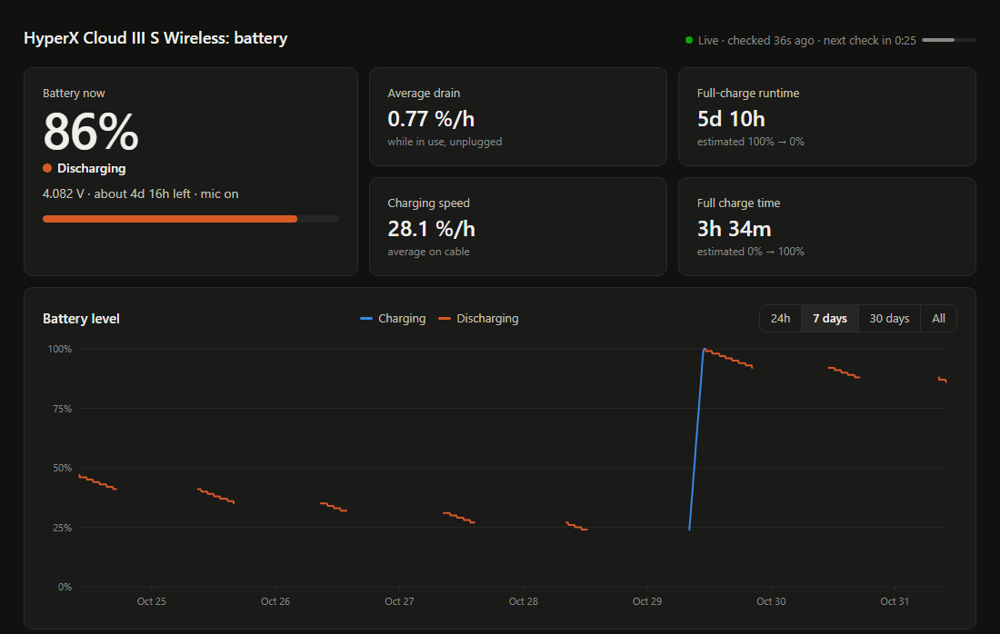
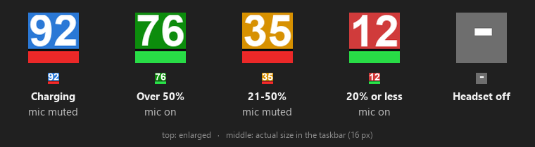
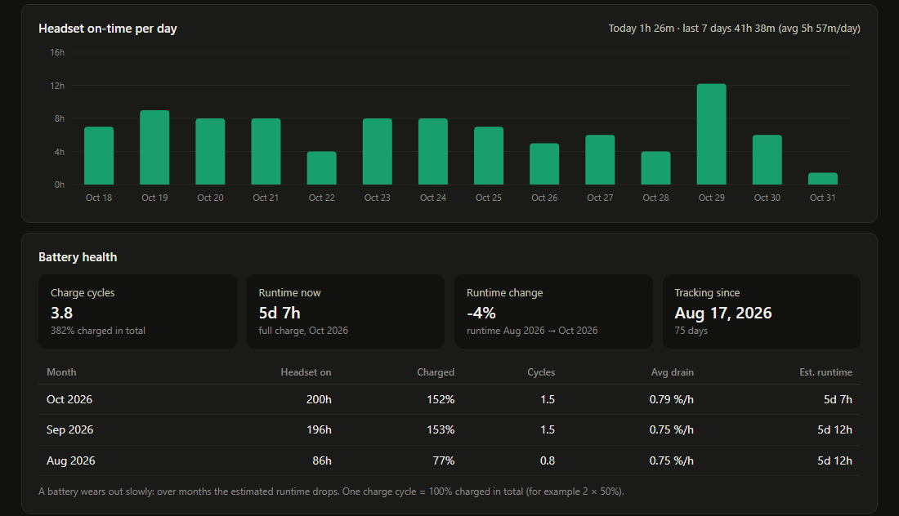
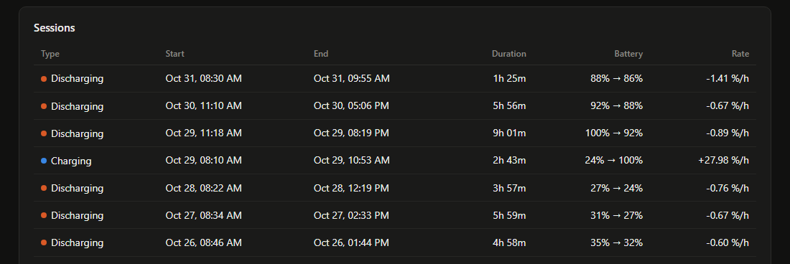

# HyperX Battery Logger

Battery history, charging detection and a live dashboard for the **HyperX Cloud III S Wireless** headset on Windows.

HyperX NGENUITY shows the battery level but keeps no history. This tool reads the battery straight from the headset's USB dongle every minute, saves every reading, and shows it all in a dashboard: how fast the battery drains, how long a charge lasts, how much you use the headset and how the battery ages over the months.



> Screenshots use example data covering about 2½ months so every section has something to show.

## Features

- **Battery logging**: battery % and voltage, checked every 60 seconds and saved to a JSON file.
- **Exact charging detection**: the headset sends a signal when the cable is plugged in or unplugged, and the logger listens for it.
- **Mic mute status**: shown in the tray icon and on the dashboard.
- **Tray icon**: the battery % next to the clock, colored by battery level, with a red or green strip for the mic.
- **Notifications**: at 20% and 10% ("time to charge"), and at 100% ("you can unplug"). Optionally also at 80% while charging, which is easier on the battery.
- **Check now**: from the tray menu or the dashboard, to get a fresh reading without waiting for the next check.
- **Live dashboard**: a local HTML page that refreshes itself after every check, with a countdown to the next one.
  - Battery level chart (24h / 7 days / 30 days / all) with hover details
  - Average drain, full-charge runtime, charging speed, time left / time to full
  - Hours the headset was on, per day
  - Battery health: charge cycles and how the runtime changes month by month
  - A list of every charge and discharge session
- **Starts with Windows**: runs hidden at login and can be turned off in Task Manager.
- Runs alongside HyperX NGENUITY without conflicts.

## Supported headsets

| Headset                                                                                               | Connection                                | Status                                                              |
| ----------------------------------------------------------------------------------------------------- | ----------------------------------------- | ------------------------------------------------------------------- |
| **HyperX Cloud III S Wireless**                                                                 | 2.4 GHz USB dongle (USB ID `03F0:06BE`) | ✅ Tested                                                           |
| HyperX Cloud III S Wireless                                                                           | Bluetooth only                            | ❌ The battery is read through the dongle, so it must be plugged in |
| Other HyperX headsets (Cloud III Wireless, Cloud II Wireless, Cloud Alpha Wireless, Cloud Flight, …) | –                                        | ❌ Different USB IDs and protocols, not supported                   |

Not sure which dongle you have? Run this in PowerShell; it lists `VID_03F0&PID_06BE` if it's the supported one:

```powershell
Get-PnpDevice -PresentOnly | Where-Object InstanceId -match 'VID_03F0&PID_06BE'
```

Adding another headset means finding its USB ID and its battery command (see [How it works](#how-it-works)). For other HyperX models, [HyperX-Cloud-2-Battery-Monitor](https://github.com/auto94/HyperX-Cloud-2-Battery-Monitor) and [HeadsetControl](https://github.com/Sapd/HeadsetControl) are good starting points.

## Requirements

- Windows 10 or 11
- Python 3.8 or newer
- Python packages: `hidapi`, `pystray`, `pillow` (listed in `requirements.txt`)

## Setup

1. **Install the packages** (with the same Python you'll run the logger with):

   ```powershell
   python -m pip install -r requirements.txt
   ```

   The package is called `hidapi`. A different package named `hid` has another API and won't work.
2. **Check that the headset is found.** Turn the headset on with the dongle plugged in, then run:

   ```powershell
   python hyperx_battery_logger.py --once
   ```

   You should see something like `{'t': '…', 'state': 'connected', 'pct': 92, 'mv': 4174, 'mic': 'muted'}`.
3. **Start it with Windows** (this also starts it right away):

   ```powershell
   powershell -ExecutionPolicy Bypass -File install_autostart.ps1
   ```

   This puts `HyperX Battery Logger.vbs` in your Windows Startup folder. It starts the logger hidden, with no console window.
4. **Open the dashboard:** double-click `battery_dashboard.html`, or right-click the tray icon and choose **Open dashboard**.

## Using it

### Tray icon



- **The number** is the battery %.
- **Background color**: blue = charging, green = over 50%, orange = 21–50%, red = 20% or less, gray = headset off.
- **Bottom strip**: red = mic muted, green = mic on.
- **Hover** for details (for example `92% - Charging - Mic muted - 4.17 V`).
- **Right-click** for the menu:
  - **Check now**: reads the headset right away
  - **Open dashboard** (also on double-click) and **Open data folder**
  - **Notify at 80% while charging**: turns the 80% alert on or off (off by default; the choice is remembered)
  - **Quit logger**: stops the logger until the next login

> If you don't see the icon, Windows may have hidden it under the **^** arrow next to the clock. Drag it onto the taskbar to keep it visible.

### Dashboard

The top of the page shows the current battery level and the averages calculated from your history. The dot at the top right is green while the logger is running and red if it stopped. The countdown shows when the next check happens. The page loads the new data a few seconds after each check, so you can leave it open. The **Check now** button next to the countdown asks the logger for a fresh reading right away; the page updates within a couple of seconds.



- **Headset on-time per day**: hours the headset was switched on, for the last 14 days. Hover over a bar for the exact time.
- **Battery health**: one *charge cycle* = 100% charged in total (for example 2 × 50%). *Runtime change* compares the estimated full-charge runtime of your first month with the latest one. A slowly falling runtime is normal battery wear. This section needs a few weeks of data before it means much.



- **Sessions**: every charge and discharge period longer than 10 minutes, with its duration and rate (% per hour). Time spent sitting at 100% on the cable doesn't count toward the charging speed.

### Notifications

Windows notifications appear when the battery drops to **20%** and to **10%**, and when it reaches **100%** while charging.

Lithium batteries wear more slowly when they aren't kept at 100%. To get a reminder to unplug at **80%** instead, turn on **Notify at 80% while charging** in the tray menu. If they don't show up, check *Settings → System → Notifications* and make sure notifications are allowed for Python.

## Turning it off

- **Pause autostart**: Task Manager → **Startup** tab → **HyperX Battery Logger.vbs** → **Disable**. Choose **Enable** to turn it back on.
- **Stop it now**: right-click the tray icon → **Quit logger**.
- **Remove it completely** (removes the autostart and stops the logger; your data is kept):

  ```powershell
  powershell -ExecutionPolicy Bypass -File install_autostart.ps1 -Uninstall
  ```

## Files and data

```
hyperx_battery_logger.py   the logger (tray icon, notifications, saving)
battery_dashboard.html     the dashboard, open it in any browser
install_autostart.ps1      start with Windows / -Uninstall
requirements.txt           Python packages
tests/                     unit tests (python -m unittest discover -s tests)
data/
  battery_log.jsonl        all readings, one JSON object per line (your history, keep this file)
  battery_data.js          the same readings for the dashboard
  battery_live.js          the latest check (rewritten every check, a few hundred bytes)
  settings.json            tray menu settings (the 80% alert)
  logger.log               errors and warnings
  logger.lock              stops a second logger from running at the same time
docs/                      README images
```

A reading is saved when something changes (battery %, charging, mic) or at least every 5 minutes. New readings are **appended** to the end of the log, so the history is never rewritten. A year of use is about 5–10 MB. Each line looks like this:

```json
{"t": "2026-10-31T09:54:39+02:00", "state": "connected", "pct": 92, "mv": 4174, "chg": 1, "mic": "muted"}
```

| Field     | Meaning                                                                                                                              |
| --------- | ------------------------------------------------------------------------------------------------------------------------------------ |
| `t`     | local time of the reading, with the UTC offset (older readings may have no offset; they're read as local time)                     |
| `state` | `connected`, or `disconnected` (headset off / dongle unplugged / out of range)                                                   |
| `pct`   | battery % (0–100)                                                                                                                   |
| `mv`    | battery voltage in millivolts                                                                                                        |
| `chg`   | `1` = cable plugged in, `0` = not. Missing when unknown (right after the logger starts, until the cable is plugged or unplugged) |
| `mic`   | `muted` or `live`                                                                                                                |

The `.js` files exist because browsers don't let a page opened from your disk read a `.json` file. The dashboard loads the data through `<script>` tags instead. It reloads the small `battery_live.js` after every check, and `battery_data.js` only when a new reading was added.

If the log gets damaged (for example by a power cut mid-write), the logger skips the broken lines, keeps the original as `battery_log.jsonl.bad-<date>` and carries on. Logs from older versions (`battery_log.json`) are converted automatically on the first start, and the old file is kept as `battery_log.json.bak`.

Logger options:

```powershell
python hyperx_battery_logger.py                 # normal: tray icon, check every 60 s
python hyperx_battery_logger.py --interval 30   # check every 30 s
python hyperx_battery_logger.py --no-tray       # console output only
python hyperx_battery_logger.py --once          # print one reading and exit
```

## How it works

The dongle shows up as a USB HID device. The logger opens its vendor collection (usage page `0x01C0`) and keeps it open. It does two things:

**1. It asks for values** by sending a 52-byte output report `0c 02 03 01 00 <cmd> 00…`. The reply starts with the same 6 bytes, followed by the value:

| Command         | Reply (after the 6 echoed bytes)                                                             |
| --------------- | -------------------------------------------------------------------------------------------- |
| `06`          | battery %, then voltage in mV (2 bytes, big-endian). For example `5a 10 4c` = 90%, 4172 mV |
| `04`          | mic: `01` = muted, `00` = on                                                             |
| `0a` / `0c` | firmware versions (`04 01 02 04`, `03 01 02 04`)                                         |
| `12`          | internal name, `HyperX Cloud MIX 2`                                                        |

**2. It listens for events** that the headset sends by itself, as `0d 02 03 00 <event> <value>`:

| Event  | Value                                                   |
| ------ | ------------------------------------------------------- |
| `01` | new battery %                                           |
| `03` | mic: `01` = muted, `00` = on                        |
| `0a` | charging cable: `01` = plugged in, `00` = unplugged |
| `0c` | headset: `01` = on, `00` = off                      |

Charging can't be asked for; it's only known from the `0a` event. Until that event arrives, the logger and dashboard guess charging from the battery trend: the % rising, or the voltage jumping by more than 25 mV when the cable is plugged in or pulled out.

**Check now from the dashboard:** a page opened from disk can't talk to a program directly, so the logger also listens on `http://127.0.0.1:47821`. Only your own PC can reach it, and the only thing it accepts is `POST /check`, which triggers an immediate reading. Requests from websites are refused (only the local dashboard and local tools are allowed), so a page you visit can't trigger checks. If that port is taken, the logger runs without it and the dashboard hides the button.

The battery command and the battery and power events come from [gear-tray](https://github.com/dddd-zdf/gear-tray). The charging and mic events were found by watching the headset while plugging and unplugging the cable and pressing mute.

## Troubleshooting

| Problem                                        | Fix                                                                                                          |
| ---------------------------------------------- | ------------------------------------------------------------------------------------------------------------ |
| `--once` prints `disconnected`             | Turn the headset on and make sure it's connected through the dongle (not Bluetooth only).                    |
| `ModuleNotFoundError: No module named 'hid'` | Install `hidapi` with the same Python you run the script with: `python -m pip install hidapi`.           |
| Dashboard says "No data file found"            | The logger hasn't run yet. Start it (step 3), then reload the page.                                          |
| Red dot: "Logger isn't running"                | It was quit, disabled in Task Manager, or Python crashed. Run `install_autostart.ps1` again to restart it. |
| Something looks wrong                          | Check `data/logger.log`. Errors are written there; the logger keeps running and retries after an error.     |
| "Another logger is already running."           | Only one copy can run at a time. Quit it from the tray icon first.                                           |
| Charging shows as guessed right after startup  | Normal. The exact state arrives with the next plug or unplug of the cable.                                   |

## Contributing

This project is meant to grow. Forks, issues and pull requests are all welcome, big or small.

Some ideas to start with:

- **Support for more headsets**: other HyperX models (Cloud III Wireless, Cloud Alpha Wireless, …) or other brands. Usually this only needs the USB ID and the battery command.
- **Mic detach detection**: the headset sends event `09`, but it flickers and needs more testing.
- **Headset controls**: sidetone, auto-off timer or a mute hotkey, if someone can capture the commands NGENUITY sends.
- **Linux / macOS support**: `hidapi` works there; the tray, autostart and file locking are Windows-only for now.

If you have a different HyperX headset, even just opening an issue with its USB ID (`VID_03F0&PID_xxxx` from Device Manager) helps.

## Credits

- [gear-tray](https://github.com/dddd-zdf/gear-tray): the battery command and event format for the Cloud III S dongle.
- [HyperX-Cloud-2-Battery-Monitor](https://github.com/auto94/HyperX-Cloud-2-Battery-Monitor): reference for HyperX headset battery reading.

Not affiliated with HyperX or HP.
